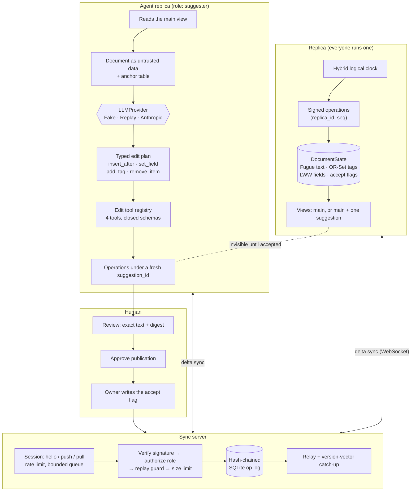

# crdt-coedit-agents

Humans and LLM agents edit one structured document at the same time, from different machines, some
of them offline. Replicas converge mathematically rather than by locking or by last-write-wins,
every operation is signed by its author, and an agent's edits stay invisible suggestions until a
human accepts them.

## Problem

Shared agent memory is usually a JSON blob behind a lock, or behind last-write-wins. Both fail the
same way once more than one writer exists:

- **Concurrent edits overwrite each other.** Two agents, or an agent and a person, write the blob a
  second apart and one of them silently loses their work.
- **An offline agent cannot merge.** It comes back with a stale copy and either clobbers what
  happened while it was away or has to throw its own work out.
- **Nobody can tell who changed what.** There is no authorship, so "the agent added that" is a
  guess.
- **Rejecting an agent's edit corrupts concurrent work.** Reverting a blob to a previous version
  also reverts whatever a person wrote in the meantime.

This repository takes the opposite approach at each point: a conflict-free replicated data type so
merging is defined rather than arbitrated, Ed25519 signatures so authorship is checkable without
trusting the server, and a suggestion layer where acceptance is an ordinary commuting write instead
of a revert.

## Architecture



Four ideas hold it together.

**The document is four CRDTs.** A Fugue sequence for text, an observed-remove set for tags, a
last-writer-wins register map for fields, and a second register map for accept flags. Each is a
join-semilattice, so the product is one, so merging is commutative, associative and idempotent.
Replicas that have seen the same operations hold byte-identical state regardless of arrival order.

**Positions are resolved by the author.** An insert carries the tree position it resolved to, not
the anchor it aimed at. A receiver never re-interprets it, so placement cannot depend on what each
replica happened to have seen.

**Identity is arithmetic, not policy.** `replica_id = sha256(public_key)[:16]`. Verification
recomputes the id from the key the operation presents, so a spoofed author is caught without a key
registry. A per-document JWT pins a connection to one replica id and one role, so a stolen token
and a stolen key are both needed to write as someone else.

**Agent edits are ordinary operations behind a flag.** They are signed, replicated and hidden. A
last-writer-wins register says whether a suggestion is visible, and only the `owner` role may write
it. Accepting commutes with concurrent typing; rejecting leaves the main view byte-identical to a
history in which the agent never ran.

Layout:

```text
src/crdt_coedit_agents/
  crdt/      hlc, ids, lww, orset, fugue, document      # the primary pattern
  ops/       model, signing, apply, log                  # signed operations and the hash chain
  sync/      protocol, auth, hub, session, client, ws    # the server, the client, the transports
  agents/    tools, planner, scripted, replica, runner   # suggest-only agent replicas
  replica.py netsim.py snapshot.py review.py demo.py cli.py
tests/unit tests/integration tests/property
bench/bench_baseline.py bench/bench_crdt.py   docs/CRDT_SEMANTICS.md  docs/THREAT_MODEL.md
```

## Quickstart

Requirements: [uv](https://docs.astral.sh/uv/) and Python 3.12. Nothing below needs a network or an
API key.

```bash
uv sync --frozen
uv run python tasks.py demo    # the whole story end to end, offline
uv run python tasks.py check   # ruff, mypy --strict, pytest + coverage, bandit, pip-audit, baseline
uv run python tasks.py bench   # benchmarks with regression thresholds
```

On Windows with a small repository drive, keep the environment elsewhere first:
`$env:UV_PROJECT_ENVIRONMENT = "C:/Users/<you>/.venvs/crdt-coedit-agents"`.

The demo runs the real sync service in process over in-memory channels — the same hub, the same
session state machine, the same role policy — with an owner and two agents. It writes a document,
lets one agent propose an edit, has a human approve exactly what that agent showed, partitions the
second agent, keeps editing on both sides, heals, and prints the convergence hash. Then the owner
accepts one suggestion and rejects the other:

```json
{
  "converged": true,
  "partition_caused_divergence": true,
  "replica_hashes": {"drafter": "bb5747dc5bd69655", "offline": "bb5747dc5bd69655",
                     "owner": "bb5747dc5bd69655", "server": "bb5747dc5bd69655"},
  "initial_text": "Release 2.4 ships faster sync and clearer errors.",
  "final_text": "Release 2.4 ships faster sync and clearer errors. Upgrading is a drop-in replacement. Thanks to everyone who reported issues.",
  "rejected_suggestion_left_no_trace": true,
  "op_log": {"ok": true, "entries": 137},
  "audit_log": {"ok": true, "entries": 14},
  "snapshot_restored": true
}
```

Running the service and an agent for real:

```bash
uv run crdt-coedit-agents keygen --key var/owner.key
export APP_SYNC_JWT_SECRET=$(openssl rand -hex 32)
uv run crdt-coedit-agents serve &

uv run crdt-coedit-agents keygen --key var/agent.key
uv run crdt-coedit-agents agent release-notes \
    --instruction "Add a short upgrade note at the end." --key var/agent.key --wait-seconds 120 &

uv run crdt-coedit-agents review list                       # what is waiting for a human
uv run crdt-coedit-agents review decide <request-id> --approve   # gate 1: may it be published
uv run crdt-coedit-agents accept release-notes <request-id> --key var/owner.key   # gate 2
uv run crdt-coedit-agents doc show release-notes            # the main view
uv run crdt-coedit-agents doc verify release-notes          # re-check the chain and every signature
```

With no `ANTHROPIC_API_KEY`, the agent uses a scripted offline planner and says so
(`"provider": "fake"`). With a key it uses `claude-opus-5` through the SDK. Either way it has the
`suggester` role and cannot write an untagged operation or an accept flag.

Containers: `docker compose up --build` runs the server and two headless agents that propose and
then wait for a human, with the review step run through `docker compose run --rm cli`. Container
build, smoke test, trivy scan and SBOM generation are verified in CI
(`.github/workflows/ci.yml`, job `docker`); they were not run locally as part of building this.

## Results

Measured with `uv run python tasks.py bench` (which runs `bench/bench_baseline.py --check` and
`bench/bench_crdt.py --check`) on 2026-09-21: Windows 10 (10.0.19045), Intel64 Family 6 Model 158
Stepping 10, 6 logical CPUs, Python 3.12.14. Latency per operation in microseconds. CI runs the
same commands against the looser limits in `bench/thresholds.json` and `bench/thresholds_crdt.json`;
this run printed "all benchmarks within thresholds" for both.

| benchmark | runs | p50 (us) | p95 (us) | ops/s at p50 |
|---|---:|---:|---:|---:|
| local_insert (resolve + sign + apply) | 2000 | 117.0 | 146.3 | 8 547 |
| remote_apply_verified (verify + apply) | 2000 | 149.8 | 162.2 | 6 676 |
| merge_only (apply an already-verified op) | 2000 | 6.2 | 6.7 | 161 290 |
| materialize_20000 (cold traversal + text) | 20 | 45 112.6 | 45 901.3 | 22 |

| measurement | value |
|---|---:|
| state memory, 100 000 elements (`tracemalloc`) | 44 494 KiB resident, 456 bytes per element |
| delta vs full state, 1 operation behind | 542 B of 2 022 039 B (0.027%) |
| delta vs full state, 10 operations behind | 5 096 B (0.25%) |
| delta vs full state, 100 operations behind | 50 636 B (2.5%) |
| convergence, 5 replicas × 400 operations, each in a different random order | 1 distinct state hash, 1 distinct view |

What these numbers say:

- **The signature is the cost.** Applying an already-verified operation is 6.2 µs; verifying one
  first takes 150 µs. Not trusting the sync server costs roughly 24× per remote operation, and it
  is still about 6 700 operations per second on one core.
- **Inserting is cheap, materializing is not.** A local insert is constant-time in the document
  length; turning a 20 000-element document into text takes 45 ms and is cached until the node set
  changes. That is the trade the tree makes, and it is why a replica materializes on demand rather
  than after every operation.
- **Delta synchronization earns its keep.** A replica ten operations behind downloads 0.25% of what
  a full-state transfer would cost.
- **Convergence is exact, not approximate.** Five replicas receiving the same 400 operations in
  five different random orders end on one state hash and one text.

Correctness numbers come from the test suite rather than the benchmarks: 544 passing tests (1
skipped), 93.76% line and branch coverage against an 85% floor, and the convergence scenario the
specification asks for — 5 replicas, 10 000
operations, random delivery order, duplication and a partition that heals — in
`tests/property/test_convergence.py::test_five_replicas_converge_over_ten_thousand_operations`.

## Security

Threats, controls and the tests that prove them are in [docs/THREAT_MODEL.md](docs/THREAT_MODEL.md);
every claim below links to evidence in [CLAIMS.md](CLAIMS.md). The algebraic guarantees and their
limits are in [docs/CRDT_SEMANTICS.md](docs/CRDT_SEMANTICS.md).

- **Signed operations.** Ed25519 over the canonical envelope, domain-separated. `doc_id` and `seq`
  are inside the signature, so an operation cannot be moved between documents or renumbered. The
  replica id is derived from the public key, so a spoofed author fails arithmetic rather than
  policy. Clients verify every incoming operation themselves: a compromised server can withhold or
  reorder — both of which a CRDT tolerates — but cannot forge.
- **Replay protection.** A unique `(doc_id, replica_id, author_seq)` index makes a re-sent
  operation a duplicate and a different operation under a spent sequence number a refusal.
- **Per-document roles.** Short-lived HS256 tokens with a pinned algorithm list, required `exp`,
  `iat`, `iss` and `aud`, and a replica id the connection is bound to. `owner` decides suggestions,
  `editor` writes the document but does not decide, `suggester` may only write operations carrying
  a suggestion id. Enforced per operation, server-side.
- **Prompt-injection containment that does not rely on the model.** The document reaches the
  planner inside an `<untrusted-data>` envelope, but the envelope is a hint. The enforcing controls
  are that the plan schema has no step that could accept a suggestion or reach the network, the
  registry holds exactly four edit tools, and the server refuses `suggestion_decide` from a
  suggester even when the operation is correctly signed. A deliberately gullible model that obeys
  an injected directive is used to test all three.
- **Two review gates, doing different jobs.** An agent cannot publish until a *different* principal
  approves a record bound to a digest of exactly what that suggestion contributes; approvals are
  single-use and expire. Even once published, operations stay invisible until an owner writes the
  signed accept flag, and that flag is re-checked against the digest before it is written.
- **Budgets.** Persisted step, token and USD limits per agent, charged before and after each model
  call, surviving restarts, plus a cap on how many operations one suggestion may sign (2 000 by
  default, `APP_AGENT_MAX_OPS_PER_SUGGESTION`), checked before the first operation is created.
- **Bounded everything.** Frame size, operations per push, document size, catch-up size, subscriber
  count, per-connection message rate, outbound queue depth, text and field value sizes, field
  nesting depth. A consumer that stops reading is disconnected rather than buffered.
- **Tamper-evident history.** A per-document hash chain in SQLite whose `verify` recomputes every
  hash *and* re-checks every signature, so rebuilding the chain does not help. A separate
  hash-chained audit log records every review decision, with `audit-verify`.
- **Logs carry metadata only.** Operation kind, author, sequence number and rejection reason —
  never document content — through the redacting log pipeline. Metric labels are bounded. The sync
  token travels in the `Authorization` header, never in a URL.
- **CI**: ruff, mypy --strict, pytest with an 85% coverage floor, bandit, semgrep with repo rules,
  pip-audit, gitleaks, hadolint, a trivy image scan and a syft CycloneDX SBOM, plus a nightly
  scheduled run of the convergence properties with 10× the examples. See
  [SECURITY.md](SECURITY.md) for reporting.

## Non-goals

- **Rich text.** Elements carry plain text with no formatting marks, and there is no run-length
  encoding: a replica writes one element per character, so one keystroke is one signed operation
  on the wire. The wire accepts up to 8 UTF-8 bytes per element, and anchors are mapped per
  element, so a peer that sends more is still addressed correctly.
- **Arbitrary JSON nesting.** The document has a fixed shape — one text sequence, one flat field
  map, one tag set. Field values may be nested JSON but are opaque to the CRDT. There is no counter
  type and no move operation.
- **Tombstone garbage collection.** State grows with the number of operations ever applied, not
  with visible length: about 456 bytes per element at 100 000 elements. Snapshots compact the
  starting point but do not shrink a live document.
- **Peer-to-peer anti-entropy.** Replicas exchange deltas through the sync server. Merkle-tree
  reconciliation between peers with no server is not implemented.
- **Key rotation or revocation.** A replica id *is* its key. Losing the key means creating a new
  replica; there is no way to retire one.
- **Tamper-proof history.** The operation log is tamper-evident, not tamper-proof: whoever can
  write the database can truncate the tail, and detecting that needs a head hash stored elsewhere
  (`doc verify --expect-head`). The approval store and budget ledger are plain files and are not
  tamper-evident at all.
- **Distributed limits.** Rate limits, subscriber counts and budgets are per process. A
  multi-replica deployment needs a shared store. The per-suggestion operation cap is enforced by
  the agent process itself; the server bounds a misbehaving agent only through its per-push,
  document-size and message-rate limits, not per suggestion.
- **Injection-proof models.** The envelope helps a model separate data from instructions; the
  guarantees come from the schema, the registry and the role policy. A human can still approve a
  malicious suggestion, which is why the review record shows the exact text.
- **Live model evaluation.** Tests, demo and benchmarks never call a paid API. `AnthropicProvider`
  is tested against a mocked client, and no recorded cassettes ship with the repository.
- **Agreeing with Yjs on concurrent edits.** pycrdt is a dev-only differential oracle on *causally
  serialized* traces. YATA and Fugue order concurrent insertions differently; both are correct, and
  asserting agreement there would be asserting a coincidence.
- **A real-time editor.** There is a CLI and an HTTP/WebSocket API. There is no editor UI, no
  cursor presence and no awareness protocol.

## Licence

MIT. See [LICENSE](LICENSE).
