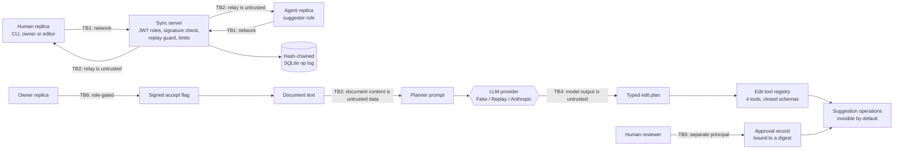

# Threat model

Method: STRIDE per trust boundary. Each row maps a threat to the control that addresses it and to
the test, bench script or CI job that proves the control works. `scripts/check_baseline.py` verifies
that every backticked evidence reference exists.

The system this covers: several replicas — people and LLM agents — editing one document through a
sync server, where the server is *not* trusted to be honest about content, and the agents are not
trusted at all.

## System and trust boundaries

Assets: the integrity and authorship of document content, the accept decision itself, provider
credentials and spend, audit evidence, and the availability of the sync service.

Assumptions: TLS terminates in front of the service; the host and container runtime are trusted;
the JWT signing secret and each replica's private key are held only by their owner; principals in
approval records are bound to authenticated identities by whoever issues tokens.

## STRIDE table

| ID | STRIDE | Threat | Entry point / asset | Control | Test / evidence | Residual risk |
|---|---|---|---|---|---|---|
| S1 | Spoofing | A replica publishes operations attributed to someone else | TB1, operation authorship | Replica id is `sha256(public_key)[:16]`; verification recomputes it from the presented key before checking the signature, so an id cannot be claimed without the key | `tests/unit/test_signing.py::test_a_spoofed_replica_id_is_detected_even_with_a_valid_signature`, `tests/unit/test_signing.py::test_a_replica_id_is_derived_from_the_public_key` | Key loss is identity loss: there is no rotation or revocation |
| S2 | Spoofing | A stolen token is used to write as another replica | TB1, sync endpoint | The token pins one replica id; every submitted operation must be authored by it, and authorship needs the private key as well | `tests/unit/test_auth.py::test_a_connection_may_only_publish_as_the_replica_its_token_pins`, `tests/integration/test_websocket_server.py::test_a_connection_without_a_usable_token_is_closed_before_it_is_accepted` | A caller holding both a token and a key is that replica |
| S3 | Spoofing | A forged or unsigned JWT grants a role | TB1, roles | HS256 with the algorithm list pinned, required `exp`/`iat`/`iss`/`aud`, document claim compared against the path | `tests/unit/test_auth.py::test_unsigned_tokens_are_refused_because_the_algorithm_is_pinned`, `tests/unit/test_auth.py::test_tokens_missing_or_misusing_claims_are_refused`, `tests/unit/test_auth.py::test_expired_and_future_tokens_are_refused` | One shared signing secret; a leak mints any role |
| S4 | Spoofing | An API key is guessed or brute-forced on the document endpoints | TB1, HTTP routes | Keys stored as SHA-256 digests, compared in constant time against every digest, failing closed with none configured | `tests/unit/test_security.py::test_every_configured_digest_is_compared_without_early_exit`, `tests/integration/test_app.py::test_protected_endpoint_requires_a_valid_api_key` | No expiry or rotation workflow |
| T1 | Tampering | The sync server rewrites an operation in transit | TB2, document content | Clients verify every incoming signature themselves; a relay can withhold or reorder (both of which a CRDT tolerates) but cannot alter | `tests/unit/test_replica.py::test_a_forged_signature_never_reaches_the_state`, `tests/integration/test_hub.py::test_a_forged_signature_is_refused_and_never_reaches_the_log` | A relay can still censor by withholding |
| T2 | Tampering | Rows in the operation log are edited, reordered or dropped | Operation log | Per-document hash chain over canonical JSON; `verify` recomputes every hash *and* re-checks every Ed25519 signature, so a rebuilt chain still fails | `tests/unit/test_oplog.py::test_verification_detects_an_edited_row`, `tests/unit/test_oplog.py::test_verification_detects_a_rebuilt_chain_with_a_forged_signature`, `tests/unit/test_oplog.py::test_truncating_the_tail_needs_an_anchored_head` | Tail truncation is only detected with an externally stored head hash |
| T3 | Tampering | An operation is replayed, or a spent sequence number is reused with new content | TB1, operation log | Unique `(doc_id, replica_id, author_seq)` index: re-sent bytes are a duplicate, different content under a spent number is refused | `tests/integration/test_hub.py::test_a_replay_of_a_spent_sequence_number_is_refused`, `tests/unit/test_replica.py::test_a_reused_sequence_number_with_different_content_is_a_replay`, `tests/unit/test_oplog.py::test_a_re_sent_operation_is_a_duplicate_and_a_different_one_is_a_replay` | Replay protection is per document; a key used on two documents needs two sequences |
| T4 | Tampering | An operation is moved to another document or renumbered | Signature coverage | `doc_id` and `seq` are inside the signed envelope | `tests/unit/test_signing.py::test_signatures_cover_the_document_id_so_operations_do_not_move_between_documents`, `tests/unit/test_signing.py::test_signatures_cover_the_sequence_number_so_operations_cannot_be_renumbered` | None known |
| T5 | Tampering | An agent adds operations to a suggestion after a human reviewed it | TB5, approval record, accept flag | Three controls, in order: the approval is bound to a digest of exactly what the suggestion contributes, and publishing re-derives it; the accept gate re-derives it again from the deciding replica's own state; and the decision itself **seals** the exact set of operations the decider saw, so anything added to that suggestion afterwards is invisible in every main view for ever. The sync server additionally refuses operations for an already-decided suggestion with the reason `suggestion_decided` | `tests/integration/test_agent_review.py::test_an_agent_that_keeps_editing_after_review_loses_its_approval`, `tests/integration/test_agent_review.py::test_the_document_gate_refuses_a_suggestion_that_changed_after_review`, `tests/integration/test_agent_review.py::test_operations_added_after_the_accept_stay_invisible_for_ever`, `tests/integration/test_agent_review.py::test_a_late_delete_inside_an_accepted_suggestion_cannot_remove_reviewed_text`, `tests/integration/test_agent_review.py::test_the_server_refuses_operations_for_a_suggestion_it_has_already_decided`, `tests/unit/test_document.py::test_a_withheld_operation_is_outside_the_seal_even_below_the_highest_sequence` | The approval file itself is not signed; protect it like the audit log. An agent that overwrites a field register inside its own accepted suggestion makes that accepted value fall back to the main document's — fail-safe, but the agent can erase its own approved field write |
| T6 | Tampering | A snapshot is edited to change the document a replica starts from | Snapshot files | Write-then-rename; the recorded state hash is recomputed on load; every element is re-checked against the same limits the operation model applies on the wire (text value bytes, tag pattern, field key, depth and size, suggestion ids, decision shape and seal runs), so a snapshot with a matching hash still cannot hold anything a signed operation could not | `tests/unit/test_snapshot_netsim.py::test_a_corrupted_snapshot_is_refused`, `tests/unit/test_snapshot_netsim.py::test_writing_a_snapshot_never_leaves_a_partial_file`, `tests/unit/test_snapshot_netsim.py::test_a_self_consistent_snapshot_that_breaks_the_operation_limits_is_refused` | A snapshot is not signed: it is trusted only as far as its filesystem, which is why the log stays authoritative |
| T7 | Tampering | A replica's clock is set far into the future to win every field write | LWW registers | The drift bound is enforced where operations enter a replica and where they enter the server: `Replica.receive` merges every verified timestamp into its own hybrid logical clock and counts an operation more than 60 s ahead of local wall time as rejected, and `DocumentHub._admit` refuses it with reason `clock_drift` before it reaches the log | `tests/unit/test_hlc.py::test_a_remote_clock_too_far_ahead_is_refused`, `tests/unit/test_replica.py::test_an_operation_dated_far_in_the_future_is_refused_on_receive`, `tests/integration/test_hub.py::test_an_operation_dated_far_in_the_future_never_reaches_the_log` | Drift inside the bound still favours the fastest clock; a peer whose clock really is more than 60 s fast has its operations dropped rather than buffered, so it must resend after correcting the clock |
| T8 | Tampering | Compromised dependency, base image or CI action | Build pipeline | `uv.lock` with hashes; pip-audit; base images pinned by digest; trivy scan; CycloneDX SBOM; Dependabot | `.github/workflows/ci.yml#pip-audit`, `.github/workflows/ci.yml#docker` | Actions are tag-pinned until SHA pinning at publish time |
| R1 | Repudiation | Dispute over who edited what, or who accepted an agent's work | Operation log, audit log | Every operation is signed by its author and chained; accept and reject are signed operations too; the review audit log is a separate hash chain with a verify command | `tests/integration/test_hub.py::test_the_hub_rebuilds_its_state_from_the_log_and_audits_decisions`, `tests/integration/test_agent_review.py::test_accepting_makes_the_suggestion_part_of_the_document`, `tests/integration/test_demos_cli.py::test_audit_verify_detects_a_tampered_log` | Timestamps are self-reported; there is no external time attestation |
| I1 | Information disclosure | Document content leaks into logs, metrics or audit records | Logs, metrics | Logs carry operation metadata only (kind, author, sequence, reason) and pass through PII redaction; metric labels are bounded to kind, scope and reason; audit data is redacted before hashing | `tests/unit/test_logging.py::test_exception_tracebacks_are_redacted`, `tests/unit/test_audit.py::test_entries_are_redacted_before_hashing`, `tests/integration/test_websocket_server.py::test_metrics_are_exposed_and_require_a_key` | An operator reading the SQLite log sees everything; that is what it is for |
| I2 | Information disclosure | A sync token ends up in a proxy log or browser history | TB1 | The token is read from the `Authorization` header, never from the URL or a query string | `tests/integration/test_websocket_server.py::test_a_connection_without_a_usable_token_is_closed_before_it_is_accepted`, `tests/unit/test_ws.py::test_open_channel_sends_the_token_in_a_header_and_bounds_frames`, `tests/unit/test_ws.py::test_the_token_is_never_part_of_the_sync_url` | A client that puts it elsewhere is out of our control |
| I3 | Information disclosure | Error bodies or protocol errors leak internals | TB1, responses | Fixed error codes and messages; protocol errors report field locations, never the frame; token errors report an exception class name | `tests/integration/test_app.py::test_unhandled_exceptions_become_generic_500s`, `tests/integration/test_app.py::test_validation_errors_never_echo_submitted_values`, `tests/integration/test_sync_session.py::test_a_malformed_frame_mid_session_is_reported_without_dropping_the_session` | None known |
| I4 | Information disclosure | An agent reads another agent's undecided suggestion | TB3, planner prompt | Agents read the *main* view; a suggestion is only visible in its own editing scope | `tests/property/test_suggestions.py::test_two_suggestions_at_one_anchor_stay_separate`, `tests/unit/test_replica.py::test_a_suggestion_is_invisible_until_it_is_accepted` | Anyone with the operation log sees every suggestion |
| I5 | Information disclosure | Secrets committed to the repository | Git history | Only `.env.example` is committed; `.env` ignored; gitleaks and the semgrep secrets pack in CI | `.github/workflows/ci.yml#gitleaks`, `.github/workflows/ci.yml#semgrep` | Scanners miss unusual secret formats |
| I6 | Information disclosure | Cross-origin pages read document responses | Browsers | Explicit origin list, no credentials, `*` refused by config validation; strict security headers | `tests/integration/test_app.py::test_cors_allows_only_configured_origins`, `tests/unit/test_config.py::test_wildcard_or_malformed_origins_are_rejected` | None known |
| D1 | Denial of service | One client floods the sync endpoint with frames | TB1, sync session | Per-connection token bucket; the connection is closed rather than throttled silently | `tests/integration/test_sync_session.py::test_too_many_frames_closes_the_connection` | In-process limits only; a fleet of clients needs a shared store |
| D2 | Denial of service | A slow consumer makes the server buffer without limit | Subscriber queues | Bounded outbound queue per subscriber; overflow closes the connection and increments a counter | `tests/integration/test_sync_session.py::test_a_client_that_stops_reading_is_disconnected`, `tests/integration/test_hub.py::test_a_subscriber_that_stops_reading_is_marked_for_disconnection` | The disconnected client must reconnect and catch up |
| D3 | Denial of service | Oversized frames, huge pushes or unbounded document growth | TB1, hub | Frame size limit while decoding; `max_ops_per_push`; per-document byte limit; bounded catch-up; subscriber count limit | `tests/integration/test_sync_session.py::test_frames_are_bounded_and_unknown_types_are_refused`, `tests/integration/test_hub.py::test_a_push_larger_than_the_limit_is_refused_whole`, `tests/integration/test_hub.py::test_a_document_stops_growing_at_its_size_limit`, `tests/integration/test_hub.py::test_catch_up_is_bounded`, `tests/integration/test_hub.py::test_a_document_refuses_more_subscribers_than_it_allows` | The size limit is checked per batch, so a document can overshoot by at most one push |
| D4 | Denial of service | Operation payloads are large, deeply nested or malformed | Operation model, snapshot loader | Text values, field values, field depth, tag length and observed-tag counts are bounded by one set of checks (`crdt/limits.py`) that both the pydantic operation model and `DocumentState.from_json` call, so the wire path and the snapshot path enforce the same bounds | `tests/unit/test_ops_model.py::test_field_values_are_bounded_in_size_and_depth`, `tests/unit/test_ops_model.py::test_text_values_are_bounded_and_may_not_contain_nul`, `tests/unit/test_ops_model.py::test_tags_are_bounded_and_observed_removes_carry_dots`, `tests/unit/test_document.py::test_a_state_that_breaks_the_operation_limits_is_refused` | Tombstones are never collected, so history grows without bound |
| D5 | Denial of service | A runaway agent burns tokens and money, or turns one model call into an unbounded number of signed operations | Planner, provider, agent replica | Persisted step, token and USD budgets per agent; one planning call per suggestion; the plan step count is capped; a plan that would sign more than `max_ops_per_suggestion` operations (2 000 by default) is refused before the first operation exists | `tests/unit/test_planner.py::test_the_step_budget_stops_a_runaway_planner`, `tests/unit/test_planner.py::test_a_plan_with_too_many_steps_is_rejected`, `tests/integration/test_agent_review.py::test_a_plan_that_would_sign_too_many_operations_is_refused_before_any_exists`, `tests/integration/test_agent_review.py::test_the_operation_cap_counts_every_operation_a_plan_would_sign` | A single call can overshoot the token or USD limit. The operation cap lives in the agent process; the server does not count operations per suggestion, so a modified agent is bounded only by the per-push, document-size and rate limits |
| D6 | Denial of service | HTTP request floods or oversized bodies | TB1, HTTP routes | Token-bucket rate limiting per verified key or client address; Content-Length and streamed body limits | `tests/integration/test_app.py::test_rate_limit_rejects_bursts_and_exempts_probes`, `tests/integration/test_app.py::test_body_size_limit_applies_to_declared_and_streamed_bodies` | In-process only; behind a proxy all clients share one address unless proxy headers are trusted |
| E1 | Elevation of privilege | Prompt injection in the document makes the agent accept its own work or reach further | TB3/TB4 | Three independent stops: the plan schema has no accept, role or network step; the registry holds exactly four edit tools; the server refuses `suggestion_decide` from a suggester even when correctly signed | `tests/unit/test_planner.py::test_an_injected_directive_cannot_produce_a_step_that_does_not_exist`, `tests/unit/test_agent_tools.py::test_there_is_no_tool_for_accepting_a_suggestion_or_reaching_the_network`, `tests/integration/test_agent_review.py::test_a_suggester_cannot_push_the_accept_flag_even_if_it_forges_the_operation`, `tests/integration/test_agent_review.py::test_an_injected_directive_cannot_produce_a_step_the_schema_does_not_have` | A human can still accept a malicious suggestion; the review record shows the exact text for that reason |
| E2 | Elevation of privilege | An agent writes untagged operations that appear in the main view directly | TB1, role policy | The `suggester` role may only write content operations carrying a suggestion id; the check is server-side and applies per operation | `tests/unit/test_auth.py::test_a_suggester_may_only_write_suggestion_scoped_content`, `tests/integration/test_hub.py::test_a_suggester_cannot_write_main_operations_or_accept_flags`, `tests/integration/test_sync_session.py::test_a_suggester_session_is_refused_the_operations_it_may_not_write` | An owner token handed to an agent removes this entirely |
| E3 | Elevation of privilege | An agent approves its own publication, or reuses one approval twice | TB5, approval store | The store refuses self-approval, refuses decisions on non-pending requests, and consumes an approval on use | `tests/integration/test_agent_review.py::test_an_agent_cannot_approve_its_own_suggestion`, `tests/integration/test_agent_review.py::test_publishing_is_refused_until_a_human_approves_that_exact_suggestion`, `tests/integration/test_agent_review.py::test_a_denied_suggestion_never_reaches_the_document` | Principal strings must come from authentication, not from the model |
| E4 | Elevation of privilege | A plan addresses something it was not shown, or a tool argument smuggles extra fields | TB4, tool registry | Closed argument models (`extra="forbid"`, strict validation); every anchor must be in the document the agent read; the whole plan is validated before a single operation is created | `tests/unit/test_agent_tools.py::test_arguments_are_validated_against_closed_schemas`, `tests/unit/test_planner.py::test_a_plan_addressing_an_unknown_anchor_is_rejected`, `tests/integration/test_agent_review.py::test_a_plan_addressing_an_element_deleted_concurrently_is_rejected` | Handlers themselves must stay safe; these four only build operations |
| E5 | Elevation of privilege | An editor decides what an agent suggested, bypassing the accountable owner | Role policy | `suggestion_decide` is owner-only; editors write the document but do not decide suggestions | `tests/unit/test_auth.py::test_an_editor_writes_the_document_but_does_not_decide_suggestions`, `tests/integration/test_hub.py::test_an_editor_writes_the_document_but_cannot_decide` | Whoever issues tokens decides who is an owner |
| E6 | Elevation of privilege | Deserialization of an artefact runs code | Snapshots, cassettes | No pickle, joblib, dill or cloudpickle anywhere; snapshots and cassettes are JSON validated by pydantic | `tests/unit/test_no_pickle.py::test_source_tree_has_no_pickle_family_serialization`, `.github/workflows/ci.yml#semgrep` | Third-party libraries may deserialize unsafely on their own paths |
| E7 | Elevation of privilege | Code execution inside the container escalates | Runtime | Non-root UID 10001; read-only root filesystem with a single `/data` volume; all capabilities dropped; no-new-privileges | `.github/workflows/ci.yml#docker` | Kernel or runtime vulnerabilities |
| E8 | Elevation of privilege | After a server-side refusal fallback, a tool call from the declined attempt is executed | TB4, AnthropicProvider | Blocks before the last `fallback` marker are dropped; executed calls and echoed content must agree | `tests/unit/test_anthropic_provider.py::test_blocks_of_a_declined_attempt_before_the_fallback_marker_are_dropped`, `tests/unit/test_providers.py::test_response_content_must_agree_with_tool_calls` | Verified against a mocked client only |

## Out of scope

Network attacks below TLS, multi-tenant isolation, key management services, and denial of service
beyond a single process. Peer-to-peer synchronization without the server is not implemented, so its
threats (anti-entropy amplification, eclipse attacks) do not apply yet. The README's Non-goals
section lists the functional gaps.
